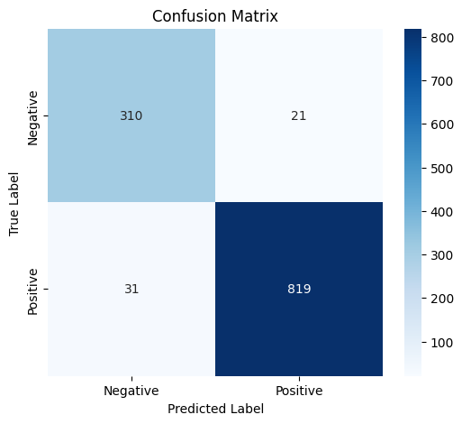

# Bengali Sentiment Analysis using Transformer Models

## Overview

This project presents a comparative study of transformer-based architectures for Bengali sentiment classification. Multiple pre-trained transformer models were fine-tuned and evaluated on a Bengali sentiment dataset to analyze their effectiveness in low-resource multilingual NLP tasks.

The project focused not only on model training, but also on:

* data preprocessing and de-duplication
* testing class-weighted loss for class imbalance
* transformer fine-tuning
* controlled comparative evaluation (fixed split, 3 seeds, significance tests)
* CPU latency measurement
* confusion matrix analysis
* qualitative error analysis
* inference API development using FastAPI
* Hugging Face model hosting

The primary objective of this work was to explore how modern multilingual transformer architectures perform on Bengali sentiment understanding.

---

# Key Results

* **XLM-RoBERTa is the most accurate model: 95.20 ± 0.11% accuracy, 94.14 ± 0.15 macro-F1** (3 seeds, one fixed test set of 1,076 texts)
* XLM-R is significantly better than DistilmBERT on all 3 seeds (McNemar p = 0.016–0.036); its +1.15-point lead over mBERT is **not** statistically significant (p = 0.105–0.144)
* Class-weighted loss made **no measurable difference** for XLM-R (negative-class recall 92.59% weighted vs 92.70% unweighted)
* 1,052 exact duplicate texts (8.9% of the dataset) were found and removed before splitting
* DistilmBERT runs about 1.8× faster on CPU (median 61–65 ms vs 112–113 ms) with half the weight size, at 1.7 points lower accuracy
* The FastAPI service serves the lighter DistilmBERT model; XLM-R is not deployed (see [FastAPI Inference API](#fastapi-inference-api))

---

# Dataset

Dataset: Bengali Sentiment Classification Dataset

Source:
[https://www.kaggle.com/datasets/saurabhshahane/bengali-sentiment-classification](https://www.kaggle.com/datasets/saurabhshahane/bengali-sentiment-classification)

The dataset contains Bengali text samples labeled with sentiment polarity.

## Task

Binary Sentiment Classification:

* Positive
* Negative

## Data used in the controlled experiments

| Step | Texts | Positive | Negative |
| ---- | ----- | -------- | -------- |
| Raw dataset | 11,807 | 8,500 | 3,307 |
| After removing 1,052 exact duplicates and 1 text with conflicting labels | 10,754 | 7,697 | 3,057 |
| Train (90%, stratified, seed 42) | 9,678 | | |
| Test (10%, stratified, seed 42) | 1,076 | 770 | 306 |

Token lengths (XLM-R tokenizer, training sample): median 18, 95th percentile 79, 99th percentile 150, so sequences were truncated at 128 tokens.

---

# Models Used

The following transformer architectures were fine-tuned and compared:

| Model       | Checkpoint                          | Description                                                         |
| ----------- | ----------------------------------- | ------------------------------------------------------------------- |
| mBERT       | `bert-base-multilingual-cased`      | Multilingual BERT baseline model                                    |
| DistilmBERT | `distilbert-base-multilingual-cased` | Lightweight distilled transformer (called "DistilBERT" in the earlier notebooks) |
| XLM-R       | `xlm-roberta-base`                  | Multilingual transformer with stronger cross-lingual representation |

---

# Project Pipeline

## 1. Data Preprocessing

The dataset was preprocessed before training:

* removed null values
* cleaned noisy text
* tokenized Bengali text using Hugging Face tokenizers
* padded and truncated sequences
* converted labels into numerical format

In the controlled experiments (`bengali_experiments.ipynb`), the data was additionally:

* de-duplicated (1,052 exact duplicate texts removed, plus 1 text that appeared with both labels)
* split once into train/test with a stratified, seeded 90/10 split shared by every model and seed
* truncated at 128 tokens with dynamic padding per batch

---

## 2. Handling Class Imbalance

The dataset is 72% positive and 28% negative (a moderate imbalance).

* class-weighted cross-entropy loss (scikit-learn "balanced" weights) was used for all models
* no resampling or dataset balancing was applied

A controlled comparison on XLM-R (3 seeds, same split) found no measurable effect of the class weights: negative-class recall 92.59 ± 1.32% weighted vs 92.70 ± 0.94% unweighted, accuracy 95.20% vs 95.29%. The unweighted comparison was not run for mBERT or DistilmBERT.

---

## 3. Transformer Fine-Tuning

All models were fine-tuned using PyTorch and Hugging Face Transformers.

Training pipeline included:

* tokenizer-based encoding
* attention masks
* AdamW optimizer (learning rate 1e-5, 3 epochs, batch size 16)
* GPU acceleration (Google Colab)
* mini-batch training
* evaluation after training

---

# Model Performance

All results below are on the same fixed test set (1,076 texts), mean ± standard deviation over 3 training seeds.

| Model | Loss | Accuracy (%) | Macro-F1 (%) | Negative-class recall (%) |
| ----- | ---- | ------------ | ------------ | ------------------------- |
| XLM-R | class-weighted | **95.20 ± 0.11** | **94.14 ± 0.15** | **92.59 ± 1.32** |
| XLM-R | unweighted | 95.29 ± 0.23 | 94.25 ± 0.27 | 92.70 ± 0.94 |
| mBERT | class-weighted | 94.05 ± 0.19 | 92.71 ± 0.25 | 90.09 ± 2.74 |
| DistilmBERT | class-weighted | 93.49 ± 0.19 | 92.05 ± 0.23 | 89.43 ± 0.82 |

## Is the gap between models real?

Exact McNemar test on the same test texts (p < 0.05 means the difference is unlikely to be noise):

| Comparison (class-weighted runs) | seed 1 | seed 2 | seed 3 |
| -------------------------------- | ------ | ------ | ------ |
| XLM-R vs DistilmBERT | 0.036 | 0.016 | 0.025 |
| XLM-R vs mBERT | 0.144 | 0.105 | 0.124 |
| mBERT vs DistilmBERT | 0.405 | 0.441 | 0.441 |

The three seeds repeat one comparison on one test set, so these p-values are not independent tests.

<details>
<summary>Per-run results (accuracy / macro-F1 / negative-class recall, %)</summary>

| Model | Loss | Seed 1 | Seed 2 | Seed 3 |
| ----- | ---- | ------ | ------ | ------ |
| mBERT | class-weighted | 94.24 / 93.00 / 91.83 | 94.05 / 92.57 / 86.93 | 93.87 / 92.57 / 91.50 |
| DistilmBERT | class-weighted | 93.68 / 92.30 / 90.20 | 93.49 / 92.01 / 88.56 | 93.31 / 91.84 / 89.54 |
| XLM-R | class-weighted | 95.26 / 94.26 / 94.12 | 95.26 / 94.18 / 91.83 | 95.07 / 93.97 / 91.83 |
| XLM-R | unweighted | 95.07 / 93.98 / 92.16 | 95.54 / 94.52 / 92.16 | 95.26 / 94.25 / 93.79 |

</details>

## Earlier notebook results (superseded)

The first per-model notebooks reported single runs of 94.07% (mBERT), 93.90% (DistilBERT) and 95.60% (XLM-R) on a 1,181-text test set. Those runs used different splits for different models and data that had not been de-duplicated, so they are not directly comparable and are superseded by the table above. The notebooks remain in the repository.

---

# Latency

CPU inference time for one text at a time (Google Colab CPU, 2 threads, batch size 1, 300 texts after 30 warm-up texts, max length 128), two alternating rounds:

| Model | Parameters | Weights | p50 | p95 |
| ----- | ---------- | ------- | --- | --- |
| DistilmBERT | 135M | 0.54 GB | 61–65 ms | 205–208 ms |
| XLM-R | 278M | 1.12 GB | 112–113 ms | 329–342 ms |

Measured on the base checkpoints (inference speed depends on the architecture, not on the fine-tuned weights). The timing includes tokenization and excludes network and FastAPI overhead. Absolute numbers will differ on other hardware.

---

# Comparative Analysis

Among all evaluated models, XLM-RoBERTa achieved the best overall performance.

Key observations:

* XLM-R is the most accurate and has the highest negative-class recall (92.6% vs 90.1% for mBERT and 89.4% for DistilmBERT), and it is significantly better than DistilmBERT on all 3 seeds
* XLM-R's lead over mBERT (+1.15 accuracy points) cannot be distinguished from noise on this test set
* mBERT's negative-class recall varies the most between seeds (86.9–91.8%)
* DistilmBERT is about 1.7 accuracy points behind XLM-R but runs about 1.8× faster on CPU with half the weight size, which makes it the practical choice for a lightweight service
* multilingual transformers achieved above 93% accuracy on Bengali sentiment without any Bengali-specific pretraining

---

# Confusion Matrix Analysis

Confusion matrix of the XLM-R model from the earlier notebook run (superseded split):



In the controlled runs, XLM-R showed:

* strong true-positive prediction capability
* the highest negative-class recall of the three models
* the highest accuracy of the three models

---

# Error Analysis

Professional qualitative error analysis was conducted on misclassified samples from the earlier XLM-R notebook run.

Errors were categorized into several linguistic groups:

| Error Type        | Description                                              |
| ----------------- | -------------------------------------------------------- |
| Sarcasm           | Positive lexical cues used in negative contexts          |
| Mixed Sentiment   | Sentences containing both positive and negative opinions |
| Ambiguous Wording | Weak or unclear sentiment polarity                       |
| Long Context      | Important contextual information missed by the model     |
| Neutral Tone      | Sentences lacking strong emotional signals               |

Example findings:

* sarcastic Bengali expressions remained difficult for transformer models
* mixed-polarity sentences caused contextual confusion
* long reviews occasionally reduced contextual focus

The analysis demonstrated that even high-performing transformer models still struggle with nuanced Bengali semantic understanding.

---

# FastAPI Inference API

A FastAPI inference pipeline was developed to convert a trained model into an accessible NLP service.

The service in `app.py` loads the **DistilmBERT** model hosted on Hugging Face ([SanjuTuni/bengali_sentiment_distilbert](https://huggingface.co/SanjuTuni/bengali_sentiment_distilbert)), the lighter of the two compared models: about 1.8× lower CPU latency and half the weight size of XLM-R. This model was fine-tuned in the earlier notebook run (93.90% on that notebook's test split); the controlled re-evaluation of the same architecture gives 93.49 ± 0.19%. The more accurate XLM-R model is not deployed.

Features:

* real-time sentiment prediction
* transformer inference endpoint
* Hugging Face model loading
* JSON-based API requests

Run locally:

```bash
pip install -r requirements.txt
uvicorn app:app --reload
```

Interactive docs are available at `http://127.0.0.1:8000/docs`.

Example Input:

```json
{
  "text": "নাটকটি অসাধারণ ছিল"
}
```

Example Output:

```json
{
  "text": "নাটকটি অসাধারণ ছিল",
  "sentiment": "Positive"
}
```

---

# Reproducing the Experiments

`bengali_experiments.ipynb` contains the full controlled run with its outputs: data cleaning, the fixed split, 12 training runs (3 models × 3 seeds, plus XLM-R without class weights × 3 seeds), the significance tests and the latency measurement.

1. Download the dataset from Kaggle (link above) and upload the two text files (`all_positive_8500.txt`, `all_negative_3307.txt`) to a Colab session with a GPU
2. Open the notebook and run the cells in order; the split uses seed 42 and the training seeds are 1, 2 and 3

Settings: learning rate 1e-5, 3 epochs, batch size 16, max length 128, fp16 on a GPU. Each run took about 2–4 minutes.

---

# Repository Contents

| File | Purpose |
| ---- | ------- |
| `bengali_experiments.ipynb` | Controlled experiments and results (used for all numbers above) |
| `Bengali_sentiment_analysis_BERT.ipynb`, `Bengali_sentiment_analysis_Distilbert.ipynb`, `Bengali_sentiment_analysis_XLMRoberta.ipynb` | Earlier per-model notebooks (superseded results; the served model was trained here) |
| `sentiment_analysis_baseline.ipynb` | English-language BERT baseline notebook, not used for the Bengali results |
| `app.py`, `requirements.txt`, `runtime.txt` | FastAPI inference service |
| `confusion_mat_XLMbert.png` | Confusion matrix from the earlier XLM-R notebook run |

---

# Technologies Used

| Technology                | Purpose                    |
| ------------------------- | -------------------------- |
| Python                    | Core programming language  |
| PyTorch                   | Deep learning framework    |
| Hugging Face Transformers | Transformer implementation |
| FastAPI                   | Inference API              |
| Google Colab              | GPU training environment   |
| Scikit-learn              | Evaluation metrics, class weights, data split |
| SciPy                     | Exact McNemar significance test |
| Matplotlib                | Visualization              |
| Pandas                    | Data handling              |

---

# Limitations

* one dataset, binary labels only; how the labels were annotated is not documented by the dataset
* a single train/test split (seeds vary training only, not the split), with a test set of 1,076 texts, so each accuracy has an uncertainty of roughly ±0.7 points
* hyperparameters were not tuned; the unweighted-loss comparison was run only for XLM-R
* the deployed model was trained in the earlier notebook, not in the controlled runs
* latency was measured once on a Colab CPU on the base checkpoints
* the per-run CSV and prediction files were lost when the Colab session ended; the saved notebook outputs are the record of the results

---

# Key Learning Outcomes

Through this project, the following concepts were explored:

* transformer architecture
* multilingual NLP
* transfer learning
* transformer fine-tuning
* testing class-imbalance strategies
* controlled experiment design (fixed splits, multiple seeds, significance testing)
* data de-duplication to avoid train/test leakage
* evaluation metrics
* qualitative error analysis
* inference pipeline development
* model hosting and deployment workflow

---

# Future Improvements

Potential future extensions include:

* serving the XLM-R model (higher accuracy, about 1.8× the CPU latency)
* larger Bengali sentiment datasets
* sarcasm-aware sentiment modeling
* Bengali-specific pretraining
* quantized lightweight deployment
* hyperparameter tuning and the unweighted-loss comparison for all models
* Streamlit-based frontend
* Docker containerization
* cloud deployment optimization

# Conclusion

This project demonstrated the effectiveness of transformer-based multilingual architectures for Bengali sentiment analysis.

The controlled experiments showed that XLM-RoBERTa achieved the strongest performance (95.20 ± 0.11% accuracy), significantly ahead of DistilmBERT and statistically indistinguishable from mBERT, while DistilmBERT offered an efficient lightweight alternative that is about 1.8× faster on CPU. Class-weighted loss made no measurable difference on this moderately imbalanced dataset.

Beyond model accuracy, the project emphasized practical NLP engineering workflows including:

* preprocessing and de-duplication
* controlled fine-tuning experiments
* significance testing
* latency measurement
* error analysis
* inference pipeline development

The work highlights both the capabilities and limitations of modern transformer models in understanding nuanced Bengali sentiment.

---

# Author

Sanjara# Bengali Sentiment Analysis using Transformer Models

## Overview

This project presents a comparative study of transformer-based architectures for Bengali sentiment classification. Multiple pre-trained transformer models were fine-tuned and evaluated on a Bengali sentiment dataset to analyze their effectiveness in low-resource multilingual NLP tasks.

The project focused not only on model training, but also on:

* data preprocessing and de-duplication
* testing class-weighted loss for class imbalance
* transformer fine-tuning
* controlled comparative evaluation (fixed split, 3 seeds, significance tests)
* CPU latency measurement
* confusion matrix analysis
* qualitative error analysis
* inference API development using FastAPI
* Hugging Face model hosting

The primary objective of this work was to explore how modern multilingual transformer architectures perform on Bengali sentiment understanding.

---

# Key Results

* **XLM-RoBERTa is the most accurate model: 95.20 ± 0.11% accuracy, 94.14 ± 0.15 macro-F1** (3 seeds, one fixed test set of 1,076 texts)
* XLM-R is significantly better than DistilmBERT on all 3 seeds (McNemar p = 0.016–0.036); its +1.15-point lead over mBERT is **not** statistically significant (p = 0.105–0.144)
* Class-weighted loss made **no measurable difference** for XLM-R (negative-class recall 92.59% weighted vs 92.70% unweighted)
* 1,052 exact duplicate texts (8.9% of the dataset) were found and removed before splitting
* DistilmBERT runs about 1.8× faster on CPU (median 61–65 ms vs 112–113 ms) with half the weight size, at 1.7 points lower accuracy
* The FastAPI service serves the lighter DistilmBERT model; XLM-R is not deployed (see [FastAPI Inference API](#fastapi-inference-api))

---

# Dataset

Dataset: Bengali Sentiment Classification Dataset

Source:
[https://www.kaggle.com/datasets/saurabhshahane/bengali-sentiment-classification](https://www.kaggle.com/datasets/saurabhshahane/bengali-sentiment-classification)

The dataset contains Bengali text samples labeled with sentiment polarity.

## Task

Binary Sentiment Classification:

* Positive
* Negative

## Data used in the controlled experiments

| Step | Texts | Positive | Negative |
| ---- | ----- | -------- | -------- |
| Raw dataset | 11,807 | 8,500 | 3,307 |
| After removing 1,052 exact duplicates and 1 text with conflicting labels | 10,754 | 7,697 | 3,057 |
| Train (90%, stratified, seed 42) | 9,678 | | |
| Test (10%, stratified, seed 42) | 1,076 | 770 | 306 |

Token lengths (XLM-R tokenizer, training sample): median 18, 95th percentile 79, 99th percentile 150, so sequences were truncated at 128 tokens.

---

# Models Used

The following transformer architectures were fine-tuned and compared:

| Model       | Checkpoint                          | Description                                                         |
| ----------- | ----------------------------------- | ------------------------------------------------------------------- |
| mBERT       | `bert-base-multilingual-cased`      | Multilingual BERT baseline model                                    |
| DistilmBERT | `distilbert-base-multilingual-cased` | Lightweight distilled transformer (called "DistilBERT" in the earlier notebooks) |
| XLM-R       | `xlm-roberta-base`                  | Multilingual transformer with stronger cross-lingual representation |

---

# Project Pipeline

## 1. Data Preprocessing

The dataset was preprocessed before training:

* removed null values
* cleaned noisy text
* tokenized Bengali text using Hugging Face tokenizers
* padded and truncated sequences
* converted labels into numerical format

In the controlled experiments (`bengali_experiments.ipynb`), the data was additionally:

* de-duplicated (1,052 exact duplicate texts removed, plus 1 text that appeared with both labels)
* split once into train/test with a stratified, seeded 90/10 split shared by every model and seed
* truncated at 128 tokens with dynamic padding per batch

---

## 2. Handling Class Imbalance

The dataset is 72% positive and 28% negative (a moderate imbalance).

* class-weighted cross-entropy loss (scikit-learn "balanced" weights) was used for all models
* no resampling or dataset balancing was applied

A controlled comparison on XLM-R (3 seeds, same split) found no measurable effect of the class weights: negative-class recall 92.59 ± 1.32% weighted vs 92.70 ± 0.94% unweighted, accuracy 95.20% vs 95.29%. The unweighted comparison was not run for mBERT or DistilmBERT.

---

## 3. Transformer Fine-Tuning

All models were fine-tuned using PyTorch and Hugging Face Transformers.

Training pipeline included:

* tokenizer-based encoding
* attention masks
* AdamW optimizer (learning rate 1e-5, 3 epochs, batch size 16)
* GPU acceleration (Google Colab)
* mini-batch training
* evaluation after training

---

# Model Performance

All results below are on the same fixed test set (1,076 texts), mean ± standard deviation over 3 training seeds.

| Model | Loss | Accuracy (%) | Macro-F1 (%) | Negative-class recall (%) |
| ----- | ---- | ------------ | ------------ | ------------------------- |
| XLM-R | class-weighted | **95.20 ± 0.11** | **94.14 ± 0.15** | **92.59 ± 1.32** |
| XLM-R | unweighted | 95.29 ± 0.23 | 94.25 ± 0.27 | 92.70 ± 0.94 |
| mBERT | class-weighted | 94.05 ± 0.19 | 92.71 ± 0.25 | 90.09 ± 2.74 |
| DistilmBERT | class-weighted | 93.49 ± 0.19 | 92.05 ± 0.23 | 89.43 ± 0.82 |

## Is the gap between models real?

Exact McNemar test on the same test texts (p < 0.05 means the difference is unlikely to be noise):

| Comparison (class-weighted runs) | seed 1 | seed 2 | seed 3 |
| -------------------------------- | ------ | ------ | ------ |
| XLM-R vs DistilmBERT | 0.036 | 0.016 | 0.025 |
| XLM-R vs mBERT | 0.144 | 0.105 | 0.124 |
| mBERT vs DistilmBERT | 0.405 | 0.441 | 0.441 |

The three seeds repeat one comparison on one test set, so these p-values are not independent tests.

<details>
<summary>Per-run results (accuracy / macro-F1 / negative-class recall, %)</summary>

| Model | Loss | Seed 1 | Seed 2 | Seed 3 |
| ----- | ---- | ------ | ------ | ------ |
| mBERT | class-weighted | 94.24 / 93.00 / 91.83 | 94.05 / 92.57 / 86.93 | 93.87 / 92.57 / 91.50 |
| DistilmBERT | class-weighted | 93.68 / 92.30 / 90.20 | 93.49 / 92.01 / 88.56 | 93.31 / 91.84 / 89.54 |
| XLM-R | class-weighted | 95.26 / 94.26 / 94.12 | 95.26 / 94.18 / 91.83 | 95.07 / 93.97 / 91.83 |
| XLM-R | unweighted | 95.07 / 93.98 / 92.16 | 95.54 / 94.52 / 92.16 | 95.26 / 94.25 / 93.79 |

</details>

## Earlier notebook results (superseded)

The first per-model notebooks reported single runs of 94.07% (mBERT), 93.90% (DistilBERT) and 95.60% (XLM-R) on a 1,181-text test set. Those runs used different splits for different models and data that had not been de-duplicated, so they are not directly comparable and are superseded by the table above. The notebooks remain in the repository.

---

# Latency

CPU inference time for one text at a time (Google Colab CPU, 2 threads, batch size 1, 300 texts after 30 warm-up texts, max length 128), two alternating rounds:

| Model | Parameters | Weights | p50 | p95 |
| ----- | ---------- | ------- | --- | --- |
| DistilmBERT | 135M | 0.54 GB | 61–65 ms | 205–208 ms |
| XLM-R | 278M | 1.12 GB | 112–113 ms | 329–342 ms |

Measured on the base checkpoints (inference speed depends on the architecture, not on the fine-tuned weights). The timing includes tokenization and excludes network and FastAPI overhead. Absolute numbers will differ on other hardware.

---

# Comparative Analysis

Among all evaluated models, XLM-RoBERTa achieved the best overall performance.

Key observations:

* XLM-R is the most accurate and has the highest negative-class recall (92.6% vs 90.1% for mBERT and 89.4% for DistilmBERT), and it is significantly better than DistilmBERT on all 3 seeds
* XLM-R's lead over mBERT (+1.15 accuracy points) cannot be distinguished from noise on this test set
* mBERT's negative-class recall varies the most between seeds (86.9–91.8%)
* DistilmBERT is about 1.7 accuracy points behind XLM-R but runs about 1.8× faster on CPU with half the weight size, which makes it the practical choice for a lightweight service
* multilingual transformers achieved above 93% accuracy on Bengali sentiment without any Bengali-specific pretraining

---

# Confusion Matrix Analysis

Confusion matrix of the XLM-R model from the earlier notebook run (superseded split):


In the controlled runs, XLM-R showed:

* strong true-positive prediction capability
* the highest negative-class recall of the three models
* the highest accuracy of the three models

---

# Error Analysis

Professional qualitative error analysis was conducted on misclassified samples from the earlier XLM-R notebook run.

Errors were categorized into several linguistic groups:

| Error Type        | Description                                              |
| ----------------- | -------------------------------------------------------- |
| Sarcasm           | Positive lexical cues used in negative contexts          |
| Mixed Sentiment   | Sentences containing both positive and negative opinions |
| Ambiguous Wording | Weak or unclear sentiment polarity                       |
| Long Context      | Important contextual information missed by the model     |
| Neutral Tone      | Sentences lacking strong emotional signals               |

Example findings:

* sarcastic Bengali expressions remained difficult for transformer models
* mixed-polarity sentences caused contextual confusion
* long reviews occasionally reduced contextual focus

The analysis demonstrated that even high-performing transformer models still struggle with nuanced Bengali semantic understanding.

---

# FastAPI Inference API

A FastAPI inference pipeline was developed to convert a trained model into an accessible NLP service.

The service in `app.py` loads the **DistilmBERT** model hosted on Hugging Face ([SanjuTuni/bengali_sentiment_distilbert](https://huggingface.co/SanjuTuni/bengali_sentiment_distilbert)), the lighter of the two compared models: about 1.8× lower CPU latency and half the weight size of XLM-R. This model was fine-tuned in the earlier notebook run (93.90% on that notebook's test split); the controlled re-evaluation of the same architecture gives 93.49 ± 0.19%. The more accurate XLM-R model is not deployed.

Features:

* real-time sentiment prediction
* transformer inference endpoint
* Hugging Face model loading
* JSON-based API requests

Run locally:

```bash
pip install -r requirements.txt
uvicorn app:app --reload
```

Interactive docs are available at `http://127.0.0.1:8000/docs`.

Example Input:

```json
{
  "text": "নাটকটি অসাধারণ ছিল"
}
```

Example Output:

```json
{
  "text": "নাটকটি অসাধারণ ছিল",
  "sentiment": "Positive"
}
```

---

# Reproducing the Experiments

`bengali_experiments.ipynb` contains the full controlled run with its outputs: data cleaning, the fixed split, 12 training runs (3 models × 3 seeds, plus XLM-R without class weights × 3 seeds), the significance tests and the latency measurement.

1. Download the dataset from Kaggle (link above) and upload the two text files (`all_positive_8500.txt`, `all_negative_3307.txt`) to a Colab session with a GPU
2. Open the notebook and run the cells in order; the split uses seed 42 and the training seeds are 1, 2 and 3

Settings: learning rate 1e-5, 3 epochs, batch size 16, max length 128, fp16 on a GPU. Each run took about 2–4 minutes.

---

# Repository Contents

| File | Purpose |
| ---- | ------- |
| `bengali_experiments.ipynb` | Controlled experiments and results (used for all numbers above) |
| `Bengali_sentiment_analysis_BERT.ipynb`, `Bengali_sentiment_analysis_Distilbert.ipynb`, `Bengali_sentiment_analysis_XLMRoberta.ipynb` | Earlier per-model notebooks (superseded results; the served model was trained here) |
| `sentiment_analysis_baseline.ipynb` | English-language BERT baseline notebook, not used for the Bengali results |
| `app.py`, `requirements.txt`, `runtime.txt` | FastAPI inference service |
| `confusion_mat_XLMbert.png` | Confusion matrix from the earlier XLM-R notebook run |

---

# Technologies Used

| Technology                | Purpose                    |
| ------------------------- | -------------------------- |
| Python                    | Core programming language  |
| PyTorch                   | Deep learning framework    |
| Hugging Face Transformers | Transformer implementation |
| FastAPI                   | Inference API              |
| Google Colab              | GPU training environment   |
| Scikit-learn              | Evaluation metrics, class weights, data split |
| SciPy                     | Exact McNemar significance test |
| Matplotlib                | Visualization              |
| Pandas                    | Data handling              |

---

# Limitations

* one dataset, binary labels only; how the labels were annotated is not documented by the dataset
* a single train/test split (seeds vary training only, not the split), with a test set of 1,076 texts, so each accuracy has an uncertainty of roughly ±0.7 points
* hyperparameters were not tuned; the unweighted-loss comparison was run only for XLM-R
* the deployed model was trained in the earlier notebook, not in the controlled runs
* latency was measured once on a Colab CPU on the base checkpoints
* the per-run CSV and prediction files were lost when the Colab session ended; the saved notebook outputs are the record of the results

---

# Key Learning Outcomes

Through this project, the following concepts were explored:

* transformer architecture
* multilingual NLP
* transfer learning
* transformer fine-tuning
* testing class-imbalance strategies
* controlled experiment design (fixed splits, multiple seeds, significance testing)
* data de-duplication to avoid train/test leakage
* evaluation metrics
* qualitative error analysis
* inference pipeline development
* model hosting and deployment workflow

---

# Future Improvements

Potential future extensions include:

* serving the XLM-R model (higher accuracy, about 1.8× the CPU latency)
* larger Bengali sentiment datasets
* sarcasm-aware sentiment modeling
* Bengali-specific pretraining
* quantized lightweight deployment
* hyperparameter tuning and the unweighted-loss comparison for all models
* Streamlit-based frontend
* Docker containerization
* cloud deployment optimization

# Conclusion

This project demonstrated the effectiveness of transformer-based multilingual architectures for Bengali sentiment analysis.

The controlled experiments showed that XLM-RoBERTa achieved the strongest performance (95.20 ± 0.11% accuracy), significantly ahead of DistilmBERT and statistically indistinguishable from mBERT, while DistilmBERT offered an efficient lightweight alternative that is about 1.8× faster on CPU. Class-weighted loss made no measurable difference on this moderately imbalanced dataset.

Beyond model accuracy, the project emphasized practical NLP engineering workflows including:

* preprocessing and de-duplication
* controlled fine-tuning experiments
* significance testing
* latency measurement
* error analysis
* inference pipeline development

The work highlights both the capabilities and limitations of modern transformer models in understanding nuanced Bengali sentiment.

---

# Author

Sanjara
